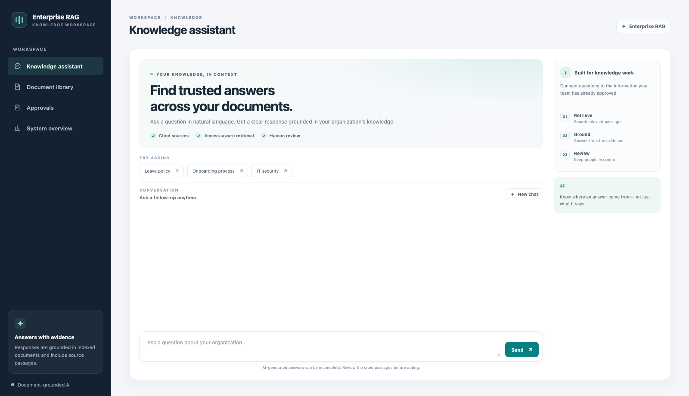
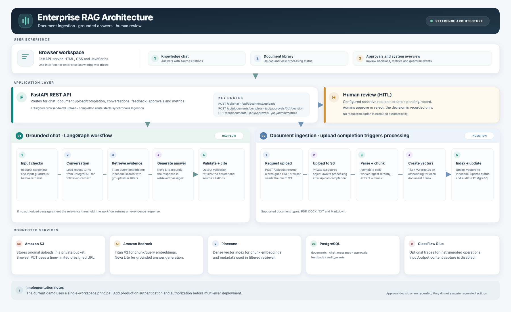

# Enterprise RAG

A document-grounded knowledge assistant for enterprise teams.

## What it does

- Answers natural-language questions with cited source passages.
- Ingests PDF, DOCX, TXT, and Markdown documents.
- Supports access-aware retrieval and human review for sensitive requests.
- Surfaces workspace and guardrail activity in an admin view.

## Architecture

FastAPI · Amazon S3 · Amazon Bedrock · PostgreSQL · Pinecone